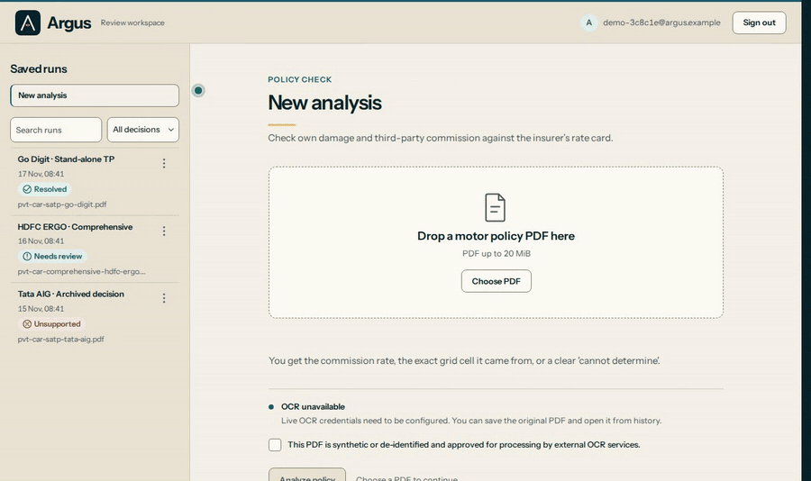
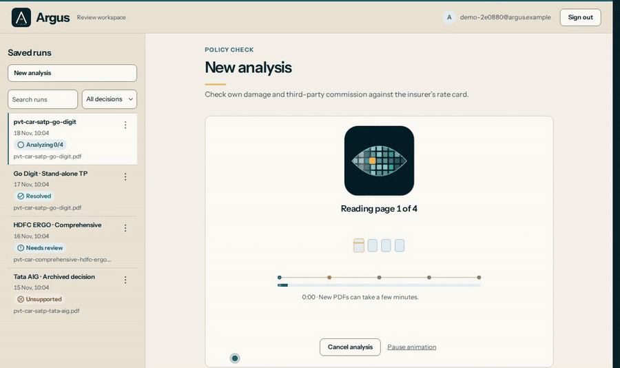
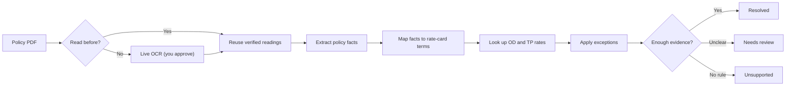

<picture>
  <source media="(prefers-color-scheme: dark)" srcset="assets/argus-banner-dark.svg">
  
</picture>

 

**Argus reads a motor policy PDF. It finds the commission rate in the insurer's rate card. It shows the exact cell it used.**

[Try it](#try-it) · [How it works](#how-it-works) · [Sample results](#sample-results) · [Data and storage](#data-and-storage)

 

- **Cited.** Every rate links to a source cell in the rate card.
- **Honest.** If the evidence is not enough, Argus says "cannot determine".
- **Fast.** A PDF that Argus has read before returns at once.

## Try it

Open the live app: **<https://argus.puneetchandna.com/>**

Sign in and upload a synthetic or de-identified policy PDF.

## What Argus does

A motor policy PDF lists facts. Examples are the insurer, the vehicle, the fuel type and the registration area.

An insurer publishes a rate card. The rate card maps those facts to a commission rate.

Argus reads the policy and applies the rate card. It returns separate decisions for Own Damage (OD) and Third Party (TP), with percentage rates where the evidence supports them. Each decision has a trace that lists every step and its source.

### 01 · Every rate has a source

Argus cites the policy page for each fact. It cites the cells that map those facts to rate-card terms. It cites the cell that holds the rate. You can check each step.

### 02 · "Cannot determine" is a valid answer

If the grid documents a coverage gap, Argus marks the run as Unsupported. Missing or conflicting evidence leads to Needs review. The screenshot shows an archived Tata AIG decision; the current sample needs review, as explained in its linked trace.

### 03 · Live progress for new PDFs

A PDF that Argus has read before returns at once. A new PDF needs live OCR. This step can take minutes. Argus shows each page as it reads it.

### 04 · You approve external OCR

Argus sends a PDF to a cloud OCR service only after you approve it. Approve each PDF. Use synthetic or de-identified PDFs only.

## Run states

| State | Meaning | What to do |
| --- | --- | --- |
| **Resolved** | Argus found every applicable rate. Each step has a source. | Read the trace. Use the rate. |
| **Needs review** | The evidence is unclear or conflicts. | Check the cited sources. |
| **Unsupported** | The supplied rate card documents a coverage gap or exclusion. | Read the reason and any separately supported component. |

## How it works

Rules that Argus follows:

- The rate card is the authority. Argus never infers a rate through a missing, declined or conflicting rule.
- Argus rates OD and TP only.
- A stand-alone TP policy has no OD rate. Argus shows OD as not applicable. It never shows zero.

The Next.js API stores uploads and renders pages with Poppler for two independent OCR readers. The TypeScript rate engine uses verified policy facts and versioned tables with the original workbook cells or PDF rows. A reviewer can correct policy readings against the original PDF. HDFC ERGO’s eligible GWP requires a brokerage record.

Independent OCR increases latency on new PDFs. The app reuses eligible readings for identical PDF bytes within the same reviewer account and rerates against the current grids. Conflicting readings or missing rating inputs lead to review. A published coverage gap leads to Unsupported. An interrupted job can resume from its saved PDF after its lease expires.

When an unread policy fact blocks a rate and its likely page is known, Argus can attempt one targeted re-read of that original page. It preserves the initial evidence, counts a repeated reader as the same source, and keeps grounded conflicts for reviewer confirmation. A re-read failure leaves the initial result available. A completed analysis with rate-blocking OCR failures can be retried once from its saved original, using its existing cloud consent and preserving confirmed facts.

## Sample results

These four traces replay source-reviewed facts from the supplied policies through the app’s rating engine. Fresh live OCR runs on **20 November 2026**, followed by source-cited reviewer confirmations where needed, produced the same component decisions and blockers shown below.

| Policy | Result | Trace |
| --- | --- | --- |
| HDFC ERGO, comprehensive | Needs review. Zone 2 OD needs eligible GWP. Package TP is unsupported. | [JSON](submission/pvt-car-comprehensive-hdfc-ergo.json) |
| Go Digit, stand-alone TP | Resolved. TP 29.5%. | [JSON](submission/pvt-car-satp-go-digit.json) |
| Reliance, comprehensive | Needs review. The workbook does not establish OD applicability on the policy start date. Package TP is unsupported. | [JSON](submission/pvt-car-comprehensive-reliance.json) |
| Tata AIG, stand-alone TP | Needs review. The printed body type does not establish private-car classification. | [JSON](submission/pvt-car-satp-tata-aig.json) |

The live checks verified saved results and original PDF bytes across refresh, a new browser context, sign-out/sign-in and a local production-server restart. See the [verification snapshot](docs/development.md#verification-snapshot-20-november-2026) for test results, coverage and remaining hosted acceptance checks.

## Data and storage

Argus saves originals in a private Supabase Storage bucket and saves results, evidence, and job state in Supabase Postgres. The API checks ownership before serving either artifact. Supabase keeps both independently of the browser and app container, so saved runs can reopen after sign-in, app restart, and redeployment. If automatic original deletion is enabled, Argus retains the PDF through required review and preserves the structured analysis after deletion.

## Development

See [the development guide](docs/development.md) for setup, local runs, testing and deployment.

## Credits

Built by [Puneet Chandna](https://puneetchandna.com) for the [Vaatun Insurance Rater Agent Challenge](https://solvetojoin.vaatun.com).
