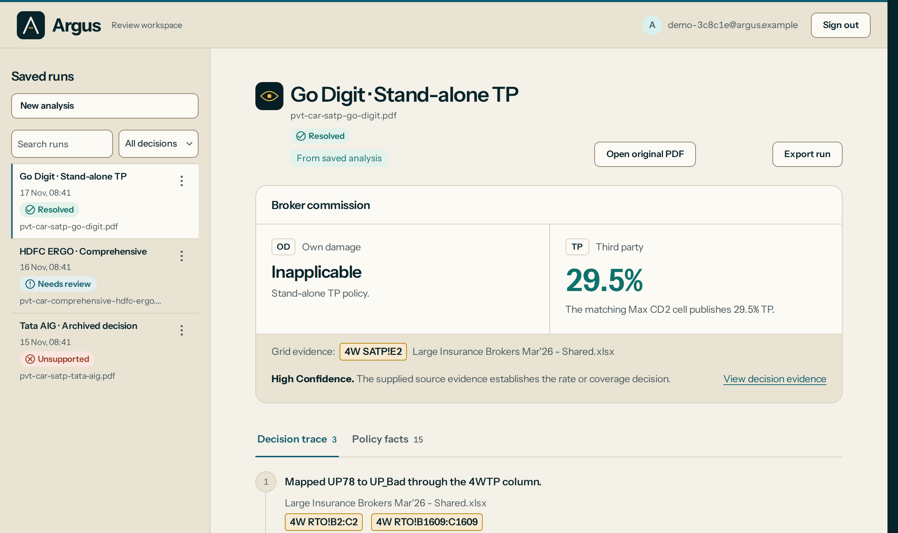
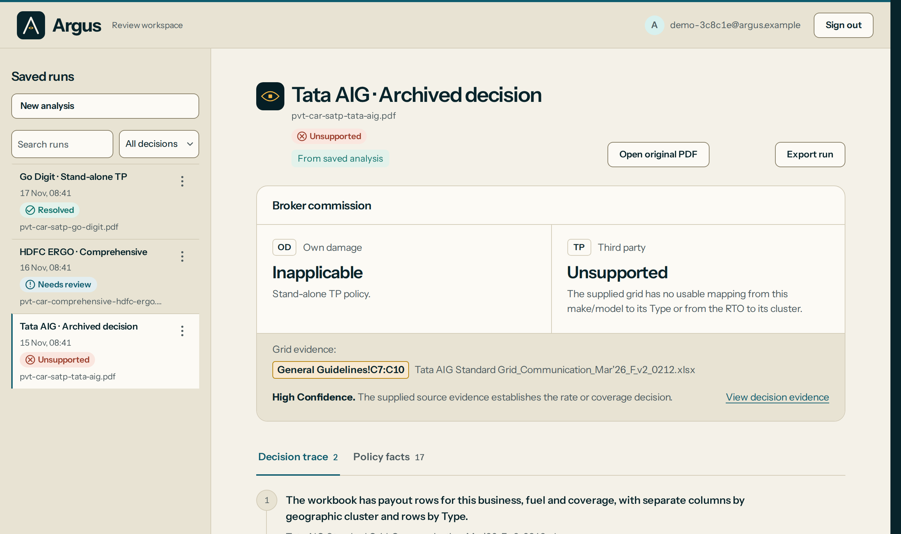
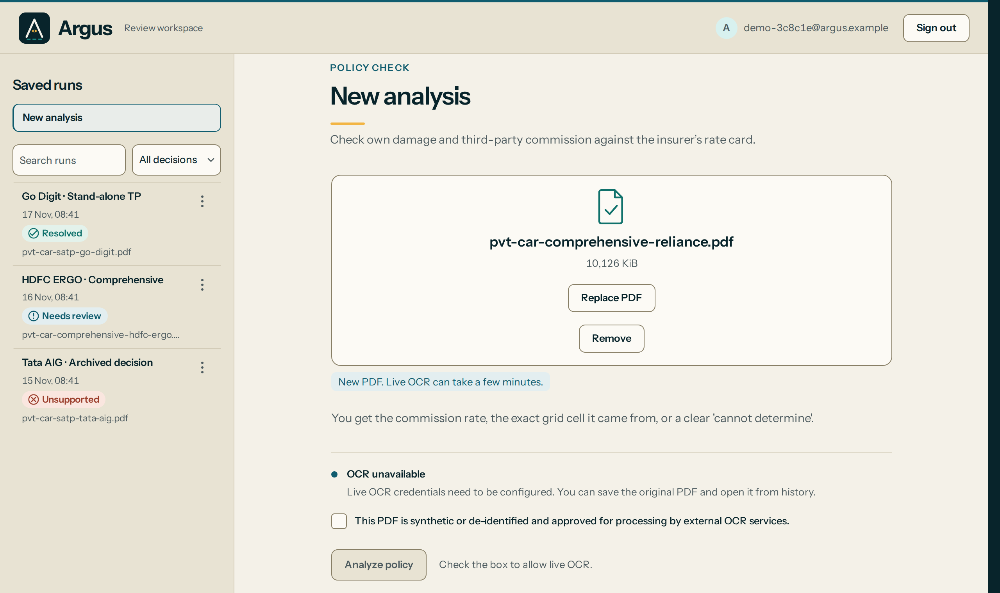
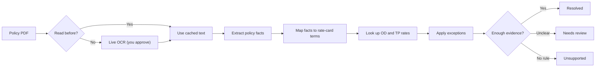

<div align="center">

<picture>
  <source media="(prefers-color-scheme: dark)" srcset="assets/argus-banner-dark.svg">
  
</picture>

<br>

[](https://argus.puneetchandna.com/)
[](https://solvetojoin.vaatun.com)

**Argus reads a motor policy PDF. It finds the commission rate in the insurer's rate card. It shows the exact cell it used.**

[Try it](#try-it) · [How it works](#how-it-works) · [Sample results](#sample-results) · [Data and storage](#data-and-storage)


</div>

<br>

- **Cited.** Every rate links to a source cell in the rate card.
- **Honest.** If the evidence is not enough, Argus says "cannot determine".
- **Fast.** A PDF that Argus has read before returns at once.

## Try it

Open the live app: **<https://argus.puneetchandna.com/>**

Sign in and upload a synthetic or de-identified policy PDF. See [local setup](#run-locally) and [deployment](#deploy-to-render).

## What Argus does

A motor policy PDF lists facts. Examples are the insurer, the vehicle, the fuel type and the registration area.

An insurer publishes a rate card. The rate card maps those facts to a commission rate.

Argus reads the policy and applies the rate card. It returns two rates: Own Damage (OD) and Third Party (TP). Each rate has a trace. The trace lists every step and its source.

### 01 · Every rate has a source

Argus cites the policy page for each fact. It cites the cells that map those facts to rate-card terms. It cites the cell that holds the rate. You can check each step.



### 02 · "Cannot determine" is a valid answer

If the rate card cannot establish a rate, Argus marks the run as Unsupported and shows the blocker. The screenshot shows an archived Tata AIG decision. The current rate lookup resolves this sample at 38% base TP.



### 03 · Live progress for new PDFs

A PDF that Argus has read before returns at once. A new PDF needs live OCR. This step can take minutes. Argus shows each page as it reads it.


### 04 · You approve external OCR

Argus sends a PDF to a cloud OCR service only after you approve it. Approve each PDF. Use synthetic or de-identified PDFs only.



## Run states

| State | Meaning | What to do |
| --- | --- | --- |
| **Resolved** | Argus found every applicable rate. Each step has a source. | Read the trace. Use the rate. |
| **Needs review** | The evidence is unclear or conflicts. | Check the cited sources. |
| **Unsupported** | The rate card has no safe rule for this policy. | Do not use a rate. |

## How it works



Rules that Argus follows:

- The rate card is the authority. Argus never infers a rate through a missing, declined or conflicting rule.
- Argus rates OD and TP only.
- A stand-alone TP policy has no OD rate. Argus shows OD as not applicable. It never shows zero.

The Next.js API stores uploads and renders pages with Poppler for two independent OCR readers. The TypeScript rate engine uses verified policy facts and versioned tables with the original workbook cells or PDF rows. A reviewer can correct policy readings against the original PDF. HDFC ERGO’s eligible GWP requires a brokerage record.

Independent OCR increases latency on new PDFs. The app reuses eligible readings for identical PDF bytes within the same reviewer account and rerates against the current grids. Conflicting readings or missing rating inputs lead to review. A published coverage gap leads to Unsupported. An interrupted job can resume from its saved PDF after its lease expires.

## Sample results

These four traces replay source-reviewed facts from the supplied policies through the app’s rating engine.

| Policy | Result | Trace |
| --- | --- | --- |
| HDFC ERGO, comprehensive | Needs review. Zone 2 OD needs eligible GWP. Package TP is unsupported. | [JSON](submission/pvt-car-comprehensive-hdfc-ergo.json) |
| Go Digit, stand-alone TP | Resolved. TP 29.5%. | [JSON](submission/pvt-car-satp-go-digit.json) |
| Reliance, comprehensive | Needs review. The workbook does not establish OD applicability on the policy start date. Package TP is unsupported. | [JSON](submission/pvt-car-comprehensive-reliance.json) |
| Tata AIG, stand-alone TP | Resolved. Base TP 38%. | [JSON](submission/pvt-car-satp-tata-aig.json) |

## Run locally

Install Node.js 24 or later, Poppler, Docker, and the Supabase CLI. Extract the [official starter bundle](https://solvetojoin.vaatun.com/downloads/insurance-rater-agent-challenge.zip) into `vaatun-starter-bundle/` alongside the pinned manifest.

```bash
npm ci
npm run verify:corpus
cp .env.example .env.local
supabase_dir=$(mktemp -d)
supabase --workdir "$supabase_dir" init
cp -r supabase/migrations "$supabase_dir/supabase/"
supabase --workdir "$supabase_dir" start
```

In `.env.local`, set `SUPABASE_URL`, `SUPABASE_PUBLISHABLE_KEY`, and `SUPABASE_SECRET_KEY` from the local project's API URL, publishable key, and secret key. The CLI's `status --output env` also reports `API_URL`, `ANON_KEY`, and `SERVICE_ROLE_KEY`. Start Argus with `npm run dev` and open <http://localhost:3000>. Set OCR keys as described in [.env.example](.env.example) only when the provider access is free and the sample is authorized.

Run `npm test`, `npm run typecheck`, and `npm run build` for local checks. The [CI workflow](.github/workflows/checks.yml) shows how to run the integration and Playwright suites against local Supabase and `npm run start`.

## Deploy to Render

Apply the [Supabase migrations](supabase/migrations) to the hosted project. Create a Render Blueprint using [render.yaml](render.yaml) and configure its three Supabase variables. Set `ARGUS_PUBLIC_ORIGIN` to the public HTTPS origin when using a custom domain. For public signup, configure the Supabase Auth site URL, the exact `<origin>/auth/confirm` redirect, and SMTP.

To check the deployment, upload an authorized synthetic PDF outside the four samples. Reopen its result and original PDF after refresh, browser reopen, sign-out and sign-in, app restart, and redeployment. Compare the original file’s SHA-256 before and after.

## Record the README demo

Start a local Supabase project with the Argus migrations and export `SUPABASE_URL`, `SUPABASE_PUBLISHABLE_KEY`, and `SUPABASE_SECRET_KEY` for that project. Use a checkout with Git history and the official starter bundle unpacked. Install Poppler, FFmpeg with `ffprobe`, and Playwright Chromium (`npx playwright install chromium`). The capture uses `gifsicle` if a GIF exceeds its size limit.

Export `NVIDIA_API_KEY` for the free NVIDIA Build endpoints. For the second reader, export `SARVAM_API_KEY` if the account has verified free credits. Otherwise Argus uses NVIDIA-hosted Mistral Large 4. Run `npm run capture:readme` to build the production app and record all assets with a disposable demo account. The hero uses a cached result. The analysis clip runs live OCR on all four pages of the official Go Digit sample and cuts the long waits. Use `npm run capture:readme -- --live-only` to refresh just that clip.

## Data and storage

Argus saves originals in a private Supabase Storage bucket and saves results, evidence, and job state in Supabase Postgres. The API checks ownership before serving either artifact. Supabase keeps both independently of the browser and app container, so saved runs can reopen after sign-in, app restart, and redeployment. If automatic original deletion is enabled, Argus retains the PDF through required review and preserves the structured analysis after deletion.

## Credits

Built by [Puneet Chandna](https://puneetchandna.com) for the [Vaatun Insurance Rater Agent Challenge](https://solvetojoin.vaatun.com).
