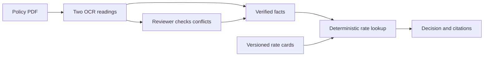

  
  <h1>Argus</h1>
  
<strong>Motor policy brokerage, with the evidence behind every decision.</strong>

  
Argus (Auditable Rate Grid Understanding System): the hundred-eyed agent that reads motor policies and resolves brokerage commission rates, citing the exact grid cell behind every answer.

  
  

    <a href="#sample-results">Sample results</a> ·
    <a href="#run-locally">Run locally</a> ·
    <a href="#verify">Verify</a> ·
    <a href="#deploy-to-render">Deploy</a>
  

Upload a motor insurance PDF to look up **own-damage (OD)** and **third-party (TP)** brokerage percentages. Argus shows the policy pages, rate-card coordinates, confidence, and the steps behind each rate or refusal. Reviewers can resolve disagreements against the original page and reopen both the PDF and result from private history.

## Sample results

These decision traces replay source-reviewed facts through the same rating engine the app uses. [Official challenge and starter bundle](https://solvetojoin.vaatun.com/)

| Policy and trace | OD | TP | Key evidence |
| --- | --- | --- | --- |
| [Go Digit · Stand-alone TP](submission/pvt-car-satp-go-digit.json) | Inapplicable | **29.5%** | RTO cluster and fuel/engine band select the SATP row. |
| [HDFC ERGO · Comprehensive](submission/pvt-car-comprehensive-hdfc-ergo.json) | Ambiguous | Unsupported | Zone 2 is established. OD needs verified fuel and eligible GWP. |
| [Reliance · Comprehensive](submission/pvt-car-comprehensive-reliance.json) | Ambiguous | Unsupported | The mapped zone, vehicle segment, and under-1,000 cc footnote are traced. Policy inception predates the grid. |
| [Tata AIG · Stand-alone TP](submission/pvt-car-satp-tata-aig.json) | Inapplicable | **38% base** | The policy’s printed RTO location matches the DELHI column. All seven CNG renewal rows agree. |

## How it works

- **Evidence.** Poppler renders pages for two independent OCR readers. A reviewer can pick a reading or enter a correction and cite its page. The TypeScript engine cites the original grid cells or PDF rows and leaves a rate open when the available evidence cannot establish it.
- **Private history.** Supabase Storage keeps the original PDF. Postgres keeps the result, evidence, and job state. The Next.js API checks ownership before serving either artifact. Both survive new sessions and container replacement. Interrupted jobs can resume from the saved PDF once their lease expires.
- **Reuse.** A repeat upload can reuse verified OCR and saved corrections for the same reviewer and PDF bytes. A reviewer can recalculate from saved facts without making another OCR request.

Configure email signup or live OCR

For public signup, enable it in Supabase Auth, set **Site URL** to your app origin and allow the exact `<origin>/auth/confirm` redirect. Set up [custom SMTP](https://supabase.com/docs/guides/auth/auth-smtp) for public confirmation emails.

Set `NVIDIA_API_KEY` for free NVIDIA-hosted OCR. Nemotron Super VL reads each page independently of the second reader. Argus tries Sarvam Vision for the second reading, then Gemini 3.8 Flash, then NVIDIA-hosted Mistral Large 4. Add `SARVAM_API_KEY` and `GEMINI_API_KEY` to use the first two routes. Use a Gemini project on Google’s free tier with billing disabled.

Sarvam runs first when configured and uses the account’s own credits. Argus tries the next reader when Sarvam rejects a request or otherwise fails. [The fallback migration](supabase/migrations/202611150005_ocr_fallback.sql) caps Gemini at 100 Argus requests per day and resets its counter at midnight Pacific time. Only Gemini uses an Argus request budget. Uploaders must authorize cloud processing for each synthetic or de-identified PDF. Set `ARGUS_OCR_CACHE_DIR` to replay compatible private reads.

## Deploy to Render

Open [Deploy to Render](https://render.com/deploy?repo=https://github.com/puneet-chandna/ARGUS), connect GitHub, and enter `SUPABASE_URL`, `SUPABASE_PUBLISHABLE_KEY`, and `SUPABASE_SECRET_KEY`. The [Blueprint](render.yaml) creates a Free Docker web service with `/api/health` and deploys gated on GitHub checks. Render supplies the default HTTPS origin. Set `ARGUS_PUBLIC_ORIGIN` if you use a custom domain. [Render Free limits](https://render.com/docs/free)

**Hosted acceptance check.** Upload an authorized policy outside the four samples. Open its result and original PDF from history after refreshing, reopening the browser, signing out and back in, restarting the app, and redeploying. Compare the PDF SHA-256 before and after.

## Reviewer profile and retention

Apply all Supabase migrations before deploying this version. The profile and preferences belong to the signed-in reviewer. Audit records are created by Auth, database transitions and successful exports; historical activity is not backfilled. An approval records consent, while an analysis records whether a cloud reader was contacted. The session list uses Supabase's device metadata. Session revocation stops refresh; an already issued access token may remain valid until it expires.

The default is to keep runs and original PDFs until deleted. With **Delete original PDFs after analysis** enabled, Argus keeps the original through any required review. After cleanup, the structured result and rate evidence remain in history. Maintenance can retry pending removals.

To enable timed retention, set `ARGUS_MAINTENANCE_SECRET` to a random secret of at least 32 characters and configure an external scheduler to send `POST /api/maintenance` with `Authorization: Bearer <secret>` at least daily. Store the secret in the scheduler's secret manager. Monitor non-2xx responses and retry them; each call handles up to 100 expired runs and 100 pending PDF removals. Do not configure the secret without an active scheduler. With no scheduler, timed retention controls are unavailable.

Personal exports include account details, the profile photo if set, preferences, analyses and activity in a ZIP of JSON and CSV files. They do not include original PDFs. Account deletion removes the local Auth account and reconciles the private PDF objects before deleting identity data. Action email notifications, geographic session lookup and two-factor enrollment are unavailable in the standard Argus configuration.

When using Supabase Cron, enable `pg_cron` and `pg_net` and provision the job with [the retention setup SQL](supabase/retention-schedule.sql). The database generates the bearer and keeps it in a private schema. Use the actual HTTPS origin of your Argus deployment. Disable the schedule and clear its configuration together to turn off timed retention.

### Reading Eye development

Apply `supabase/migrations/202611170003_reading_eye.sql` before running the updated app. The upload starts the server worker after the response; reopening a processing run reattaches to its persisted progress. A cancelled run keeps its original PDF. The run revision prevents a cancelled worker from committing a late result. The reviewer-owned status response is available at `GET /api/runs/:id?progress=1`; cancellation uses `POST /api/runs/:id/cancel`.

Set `ARGUS_FAKE_SLOW=1` (or `miss`, `miss-fail`, `partial`, or `cache-hit`) with `npm run dev` and a disposable Supabase workspace. These modes do not call OCR providers. The slow page takes 25 seconds. Production ignores this flag.

Preflight sends only the file's SHA-256. Production reuses an eligible whole-file extraction from the signed-in reviewer's cache, then rerates it against the current grids. A miss does not reveal the page count before upload. Typical time is computed once the count is known, from the reviewer's last 50 successful live observations (five minimum). Partial hits are simulated only.
