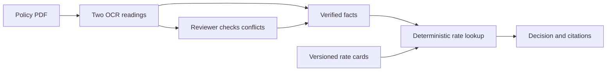

<div align="center">
  
  <h1>Argus</h1>
  <p><strong>Motor policy brokerage, with the evidence behind every decision.</strong></p>
  <p>A reviewer workspace for the Vaatun Insurance Rater Agent Challenge.</p>
  <p>
    <a href="https://github.com/puneet-chandna/ARGUS/actions/workflows/checks.yml"></a>
    <a href="https://render.com/deploy?repo=https://github.com/puneet-chandna/ARGUS"></a>
  </p>
  <p>
    <a href="#sample-results">Sample results</a> ·
    <a href="#run-locally">Run locally</a> ·
    <a href="#verify">Verify</a> ·
    <a href="#deploy-to-render">Deploy</a>
  </p>
</div>

Upload a motor insurance PDF to look up **own-damage (OD)** and **third-party (TP)** brokerage percentages. Argus shows the policy pages, rate-card coordinates, confidence, and the steps behind each rate or refusal. Reviewers can resolve disagreements against the original page and reopen both the PDF and result from private history.

## Sample results

These decision traces replay source-reviewed facts through the same rating engine the app uses. [Official challenge and starter bundle](https://solvetojoin.vaatun.com/)

| Policy and trace | OD | TP | Key evidence |
| --- | --- | --- | --- |
| [Go Digit · Stand-alone TP](submission/pvt-car-satp-go-digit.json) | Inapplicable | **29.5%** | RTO cluster and fuel/engine band select the SATP row. |
| [HDFC ERGO · Comprehensive](submission/pvt-car-comprehensive-hdfc-ergo.json) | Ambiguous | Unsupported | Zone 2 is established. OD needs verified fuel and eligible GWP. |
| [Reliance · Comprehensive](submission/pvt-car-comprehensive-reliance.json) | Ambiguous | Unsupported | The mapped zone, vehicle segment, and under-1,000 cc footnote are traced. Policy inception predates the grid. |
| [Tata AIG · Stand-alone TP](submission/pvt-car-satp-tata-aig.json) | Inapplicable | Unsupported | The grid lacks usable model-to-Type and RTO-to-cluster mappings. |

## How it works



- **Evidence.** Poppler renders pages for two independent OCR readers. A reviewer can pick a reading or enter a correction and cite its page. The TypeScript engine cites the original grid cells or PDF rows and leaves a rate open when the available evidence cannot establish it.
- **Private history.** Supabase Storage keeps the original PDF. Postgres keeps the result, evidence, and job state. The Next.js API checks ownership before serving either artifact. Both survive new sessions and container replacement. Interrupted jobs can resume from the saved PDF once their lease expires.
- **Reuse.** A repeat upload can reuse verified OCR and saved corrections for the same reviewer and PDF bytes. A reviewer can recalculate from saved facts without making another OCR request.

## Run locally

Requires **Node.js 24**, **Poppler** (`pdfinfo` and `pdftoppm`), and a Supabase project. The [Dockerfile](Dockerfile) includes Poppler.

1. Apply the [Supabase migrations](supabase/migrations) in filename order. Enable email auth and provision a confirmed reviewer under **Authentication → Users**.
2. Copy [.env.example](.env.example) to `.env.local` and fill in the three Supabase values.

   ```sh
   cp .env.example .env.local
   npm ci
   npm run dev
   ```

3. Open [localhost:3000](http://localhost:3000), sign in, and choose **New analysis**. The default limit is 20 MiB and 20 pages per unencrypted PDF.

<details>
<summary>Configure email signup or live OCR</summary>

For public signup, enable it in Supabase Auth, set **Site URL** to your app origin and allow the exact `<origin>/auth/confirm` redirect. Set up [custom SMTP](https://supabase.com/docs/guides/auth/auth-smtp) for public confirmation emails.

OCR starts in cache-only mode. Set `ARGUS_OCR_CACHE_DIR` to replay compatible private page responses. To enable fresh Sarvam Vision and NVIDIA Super VL requests, verify authorized zero-spend access for both providers, set the flags and keys in [.env.example](.env.example), and set the verified request limits in `argus_ocr_budget`. Both limits start at zero. Uploaders must explicitly authorize the use of both routes for a synthetic or de-identified policy.

</details>

## Verify

Run the same checks as [GitHub Actions](.github/workflows/checks.yml). The source PDFs and workbooks come directly from Vaatun and are verified against the pinned manifest.

```sh
curl -fL https://solvetojoin.vaatun.com/downloads/insurance-rater-agent-challenge.zip -o /tmp/vaatun-starter.zip
unzip -n -q /tmp/vaatun-starter.zip -d vaatun-starter-bundle
npm ci
npm run verify:corpus
npm run typecheck
npm test
npm run build
```

For the storage integration test, point `ARGUS_TEST_URL`, `ARGUS_TEST_SUPABASE_URL` and `ARGUS_TEST_SUPABASE_SECRET` to a running app and disposable local Supabase project with the migrations applied. Run `node --test test/storage.test.ts` to check account isolation, upload retries, PDF integrity, and reuse of confirmed fields.

## Deploy to Render

Open [Deploy to Render](https://render.com/deploy?repo=https://github.com/puneet-chandna/ARGUS), connect GitHub, and enter `SUPABASE_URL`, `SUPABASE_PUBLISHABLE_KEY`, and `SUPABASE_SECRET_KEY`. The [Blueprint](render.yaml) creates a Free Docker web service with `/api/health` and deploys gated on GitHub checks. Render supplies the default HTTPS origin. Set `ARGUS_PUBLIC_ORIGIN` if you use a custom domain. [Render Free limits](https://render.com/docs/free)

**Hosted acceptance check.** Upload an authorized policy outside the four samples. Open its result and original PDF from history after refreshing, reopening the browser, signing out and back in, restarting the app, and redeploying. Compare the PDF SHA-256 before and after.
